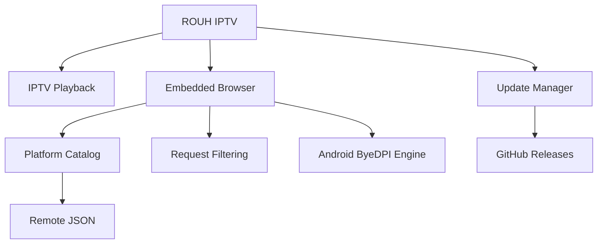
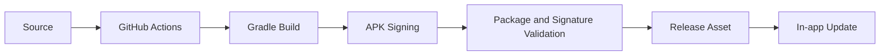

# ROUH IPTV

**مشغل IPTV**

**ومشغل لجميع مواقع الافلام والمسلسلات بدون اعلانات**

 

 

تحميل نسخة الأندرويد

  

 

تحميل نسخة الآيفون (يحتاج لتوقيع)

  

---

## نظرة عامة | Overview

**ROUH IPTV** تطبيق مستقل لتشغيل اشتراكات IPTV وتصفح المنصات عبر واجهة موحدة، مع إصدارات مخصصة لأجهزة Android وiOS.

### المزايا | Features

| الميزة | التفاصيل |
|:--|:--|
| IPTV | تشغيل المحتوى من الاشتراكات المتوافقة |
| المنصات والمواقع | تصنيفات للأفلام والمسلسلات والأنمي والمباريات |
| تجربة التصفح | متصفح مدمج مع تقليل الإعلانات والمفضلة |
| الاتصال | خيار فك الحجب باستخدام ByeDPI في نسخة Android |
| التحديثات | إدارة مستقلة لإصدارات Android وiOS |

## الإصدارات | Releases

| النظام | صيغة الملف | حالة التثبيت | الإصدار |
|:--|:--|:--|:--|
| Android | APK | موقّع وجاهز للتثبيت | [Android Release](https://github.com/wu3x/rouh-iptv-releases/releases/tag/android-latest) |
| iOS | IPA | يتطلب توقيعًا صالحًا | [iOS Release](https://github.com/wu3x/rouh-iptv-releases/releases/tag/ios-latest) |

روابط التحميل ثابتة، ويتم تحديث ملفات الإصدارات عند اكتمال عملية النشر. يمكن متابعة تفاصيل الإصدارات من [صفحة Releases](https://github.com/wu3x/rouh-iptv-releases/releases).

## التثبيت والتحديث | Installation

- **Android:** حمّل ملف APK وافتحه، ثم وافق على التثبيت. يمكن التحديث فوق النسخة الحالية عند تطابق اسم الحزمة والتوقيع.
- **iOS:** حمّل ملف IPA ووقّعه باستخدام طريقة تثبيت متوافقة مع جهازك.
- **التحديثات:** يتم نشر تحديثات كل نظام بصورة مستقلة.

## البنية التقنية | System Architecture

### Architecture Layers

| Layer | Responsibility |
|:--|:--|
| Presentation | واجهة المستخدم والتصنيفات والمفضلة |
| Playback | تشغيل مصادر IPTV المتوافقة |
| Web Runtime | إدارة جلسات التصفح والتنقل بين الصفحات |
| Network | معالجة الاتصال وفلترة الطلبات في المتصفح |
| Remote Configuration | جلب قائمة المنصات والنطاقات المسموح بها |
| Distribution | إدارة ملفات الإصدارات والتحديثات |

## دورة بناء أندرويد | Android CI/CD

- **Build environment:** Windows self-hosted runner · Android SDK 35 · Gradle.
- **Native integration:** JNI libraries for ARM64, ARMv7, x86 and x86_64.
- **Release integrity:** التحقق من هوية الحزمة والتوقيع ورقم الإصدار قبل النشر.
- **Version management:** زيادة رقم بناء أندرويد تلقائيًا بالاعتماد على الإصدار المنشور.
- **Distribution channels:** مسارات نشر مستقلة لأندرويد وiOS.

### Android Technology Stack

<b>Release contract · تفاصيل واجهة التوزيع</b>

| Property | Android | iOS |
|:--|:--|:--|
| Release tag | `android-latest` | `ios-latest` |
| Artifact | `ROUH-IPTV-Android.apk` | `ROUH-IPTV-iOS-unsigned.ipa` |
| Distribution | GitHub Releases | GitHub Releases |
| Signing | Android release signature | External signing required |

## ملاحظات تقنية | Technical Notes

تُدار قائمة المنصات مركزيًا، مما يسمح بتحديث الروابط دون الحاجة إلى إصدار جديد لبعض التغييرات. قد يختلف توفر المواقع تبعًا لحالة الخدمات الخارجية والشبكة.

التطبيق لا يستضيف المحتوى المعروض، ويتحمل المستخدم مسؤولية استخدام المصادر والاشتراكات التي يملك حق الوصول إليها.

### Open Source Acknowledgements

تستخدم نسخة Android مكونات من مشروع [ByeDPIAndroid](https://github.com/dovecoteescapee/ByeDPIAndroid) المرخص بموجب GPL-3.0. يخضع توزيع المكونات والكود المصدري المقابل لشروط تراخيصها.

---

**ROUH IPTV**

Android · iOS

[Releases](https://github.com/wu3x/rouh-iptv-releases/releases) · [Instagram](https://www.instagram.com/wu3x/)

© ROUH IPTV

